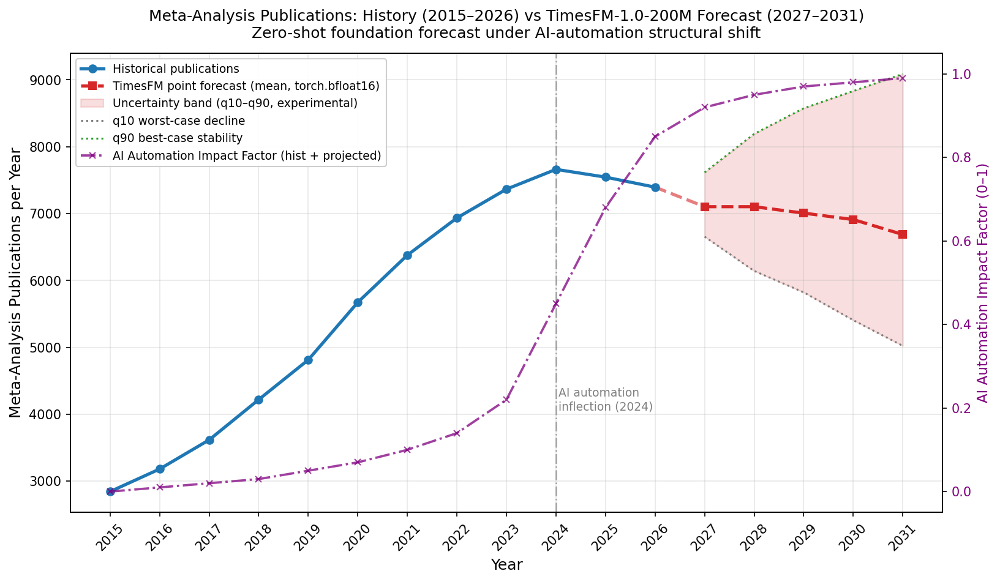

# Research Automation Toolkit

> Narrative: Data analysis will be automated in the future.
> This repository bundles a complete research-and-data-analysis toolkit with 61 specialist method guides, a TimesFM-1.0-200M zero-shot forecasting pipeline, and Mermaid skill-graph diagrams — all structured for reproducible, AI-augmented research automation.
> Copyright © Ahsan Mandhar.

---

## TimesFM Forecast: Meta-Analysis Publications (2015-2031)

Zero-shot foundation forecast under AI-automation structural shift, generated with TimesFM-1.0-200M (CPU-only, bfloat16, <2GB memory).

> Run `python analysis/timesfm_forecast_v2.py` to generate the forecast CSV, table, and PNG. Outputs land in `data/`.

---
### Skills Overview

### SRM — Statistical Research Methods (22 skills)

| Skill ID | Skill Name | Role |
|----------|-----------|------|
| s1 | srm-research-question-design | Turn a topic into an answerable quantitative research question; Extract POCI elements: Population, Outcome, Comparison, Intervention; Identify response and explanatory variables |
| s2 | srm-study-design-selection | Pick and encode the right quantitative design from POCI components; Descriptive vs analytical vs experimental design; Draft a study-design protocol |
| s3 | srm-sampling-methods | Draw and audit research samples using numpy.random and pandas.sample; Simple random, systematic, stratified, cluster sampling; Assess whether a sample can represent its population |
| s4 | srm-variable-types-encoding | Classify every variable as quantitative or qualitative; Nominal vs ordinal, discrete vs continuous; Encode into correct pandas dtype |
| s5 | srm-data-collection-protocols | Study measurement and data capture protocols; Data collection planning and execution |
| s6 | srm-numerical-summaries-quantitative | Numerically describe one quantitative variable or many by group; Mean vs median, range, sample standard deviation, variance; IQR, percentiles, standardise to z-score, flag outliers |
| s7 | srm-numerical-summaries-qualitative | Numerically summarise qualitative categorical data; Overall, row and column proportions and percentages; Odds or odds ratio from a contingency table |
| s8 | srm-graphical-summaries | Visualise distributions and relationships graphically; Publication-quality figures from pandas frames |
| s9 | srm-distributions-normal-model | Normal distribution model in pure Python; Probability density, z-scores, standard normal table |
| s10 | srm-confidence-intervals-single | Confidence interval for ONE population proportion or mean; 90/95/99% CI, margin of error, standard error; Sample size determination |
| s11 | srm-confidence-intervals-comparisons | Confidence intervals for comparisons between two groups; Paired before/after mean differences; Two independent means: Welch vs pooled; Odds ratio from four cell counts |
| s12 | srm-hypothesis-testing-framework | Hypothesis testing framework: null vs alternative; P-values, Type I and Type II errors, statistical power; Decision logic for accepting or rejecting hypotheses |
| s13 | srm-hypothesis-tests-means | t-tests: one-sample, paired/dependent, two-sample/Welch; Equal vs unequal variance assumptions; Turn a t-statistic into a P-value |
| s14 | srm-hypothesis-tests-categorical | Chi-square tests for categorical data; Independence and goodness-of-fit tests; Expected counts below 5 rule |
| s15 | srm-correlation | Scatterplot reading: form, direction, variation, outliers; Pearson correlation coefficient r and R-squared; Influential points detection |
| s16 | srm-linear-regression | Fit simple linear regression y_hat = b0 + b1*x; Least-squares OLS via pure Python; Interpret slope and intercept, test slope significance |
| s17 | srm-probability-and-decision-logic | Probability from three approaches: classical, frequentist, subjective; Independence of events, conditional probability; Expected number of outcomes |
| s18 | srm-confounding-and-blinding-experimental | Protect internal validity of an experiment treatment vs control; Balance groups, check randomisation, SRM check; A/B test and clinical trial design audit |
| s19 | srm-confounding-and-blinding-observational | Confounding and blinding for observational non-randomised studies; Cohort, cross-sectional, case-control designs; Baseline imbalance tables, crude vs adjusted numbers |
| s20 | srm-statistical-reference | Lookup reference layer for Dunn Scientific Research and Methodology; Notation dictionary, parameter vs statistic vs standard error; Verify code against book printed answers |
| s21 | srm-reporting-research | Build and QC the written scientific report following Dunn structure; AIMRaD and STARD-compliant report assembly; Results section, tables, figures, critical reading |
| s22 | srm-correlation-linear-integration | Integrate correlation and regression results; Combine r, R-squared, and regression output; Report strength of evidence and effect size |

---
### MAA — Meta-Analysis (7 skills)

| Skill ID | Skill Name | Role |
|----------|-----------|------|
| m1 | maa-effect-sizes | Compute study-level effect sizes for meta-analytic input table; Risk ratio RR, odds ratio OR on log-OR scale, risk difference RD; Variance, standard error, CI behind one effect size; Handle zero cell or dropouts |
| m2 | maa-pooling-models | Fixed- and random-effects pooling of meta-analytic evidence; Inverse-variance fixed-effect weights; Mantel-Haenszel and Peto methods; Study weights and pooled result |
| m3 | maa-heterogeneity | Heterogeneity statistics computed from first formulas; Cochran's Q with chi-square P value; I-squared, tau-squared, H-squared; Prediction interval |
| m4 | maa-forest-plots | Draw publication-quality meta-analysis forest plots; Replace unavailable PythonMeta and zEpid ForestPlot; Log versus linear axis, null-line placement; Size study marks by precision |
| m5 | maa-publication-bias | Detect publication bias and small-study effects; Contour-enhanced funnel plot with matplotlib zones; Egger and Begg P-values; Assess asymmetry in funnel plot |
| m6 | maa-subgroup-meta-regression | Subgroup contrasts and meta-regression; Sensitivity and robustness analysis; Test whether study characteristics explain pooled effect; Drop-one sensitivity analysis |
| m7 | maa-validation-vs-r-stata | Cross-validate Python meta-analysis against R meta/metafor or Stata; Write reference path for comparison; Choose cross-tool tolerance; Explain small discrepancies between tools |

---

### PDA — Python Data Analysis (13 skills)

| Skill ID | Skill Name | Role |
|----------|-----------|------|
| p1 | pda-python-language-core | Core Python language semantics for data analysis; Standard library: re, itertools, collections, pathlib, os, sys, tempfile; No third-party dependencies; Raw-Python data prep, grouping, counting with dict/set |
| p2 | pda-numpy-fundamentals | NumPy ndarray toolkit for array-oriented data work; Build, subset, aggregate NumPy arrays; Select rows by boolean mask or integer index array; Compute sum/mean along axis, sort, unique |
| p3 | pda-numpy-advanced | Advanced NumPy internals: shape, strides, flags, dtype hierarchy; Zero-copy strided views, np.issubdtype; Fix operands could not be broadcast together errors; Handle arrays too large for RAM |
| p4 | pda-pandas-foundations | Build and inspect core pandas objects: Series, DataFrame, Index; Creation from arrays, lists, dicts; Index and name attributes; Select rows/columns with loc/iloc, filter with mask |
| p5 | pda-data-loading-io | Load data into pandas DataFrame from every source; CSV, Excel, JSON, database query into DataFrame; scikit-learn toy datasets, seeded simulated generators |
| p6 | pda-data-cleaning | Clean data end to end in pure Python pandas/numpy; Drop duplicate rows, filter rows on condition; Handle NaN values, join two frames |
| p7 | pda-data-wrangling-reshape | Wrangle pandas DataFrame end to end; Creation, description head/tail/shape/describe; loc vs iloc and conditional selection; Count unique classes, group by category |
| p8 | pda-groupby-aggregation | Split-apply-combine in pure pandas/numpy; Group by array, column, dict, Series, callable, MultiIndex level; Optimized or custom aggregation functions; Per-group stats, top-n per group, pivot tables |
| p9 | pda-time-series | Date/timestamp APIs, date_range and frequency aliases; Shifting, resampling down/up-sample, OHLC; Rolling/expanding windows with min_periods, EWMA; Parse dates, handle time zones |
| p10 | pda-plotting-visualization | Build publication figures from pandas frames with matplotlib and seaborn; Plot Series or DataFrame, histogram, KDE; Subplots/panels, legend, error bars; Save figure headless |
| p11 | pda-modeling-libraries | Fit statistical and ML models from pandas frame; Patsy formula design matrices: dmatrices, standardize/center; C(), I(), key1:key2 interactions; statsmodels, patsy, sklearn integration |
| p12 | pda-ipython-jupyter-workflow | Pure-Python reproduction of IPython/Jupyter analysis workflow; Magic commands, timing, profiling, code introspection; Structure notebook for reproducibility |
| p13 | pda-analysis-examples | Analysis examples and worked demonstrations; End-to-end analysis walkthroughs; Reference implementations |

---

### MLK — Machine Learning (13 skills)

| Skill ID | Skill Name | Role |
|----------|-----------|------|
| l1 | mlk-vectors-matrices-arrays | Linear algebra for ML: vectors, matrices, tensors; Dot/inner products, norms, projections; Matrix multiply, inverse, solve; Eigenvalues, SVD, PCA mechanics, loss functions |
| l2 | mlk-data-loading | Load data into training-ready pandas/sklearn frame; scikit-learn toy datasets, seeded simulated generators; Import CSV, Excel, JSON; Query database into DataFrame |
| l3 | mlk-data-wrangling | Wrangle pandas DataFrame end to end in pure Python; Creation, description, head/tail/shape/describe; Drop duplicates, filter rows, group by category; Handle NaN, join two frames |
| l4 | mlk-datetime-features | Parse date strings and build ML-ready temporal features; to_datetime with explicit format; Break timestamp into component features; Encode day-of-week, compute time differences |
| l5 | mlk-categorical-features | Encode categorical string features into numeric ML inputs; Label and ordinal reduction, one-hot/dummy encoding; Target-encode a group, handle high-cardinality features |
| l6 | mlk-text-features | Text features for machine learning in pure Python; Strip whitespace and punctuation; CountVectorizer, TfidfVectorizer pipelines; Stemming, stop-word lists |
| l7 | mlk-numerical-features | Build ML-ready numeric features from quantitative columns; Scale, normalise, standardise numeric features; Polynomial and interaction terms; Log/sqrt transform, outlier detection, binning |
| l8 | mlk-dim-reduction-extraction | Reduce original features to smaller projected components; PCA with variance target, ICA, NMF, kernel PCA; t-SNE, TruncatedSVD; How many components keep 95% or 99% variance |
| l9 | mlk-naive-bayes | Train Gaussian, multinomial, Bernoulli naive Bayes classifiers; sklearn.naive_bayes with numpy; Compare NB variants for different data types |
| l10 | mlk-svm | Train, inspect and tune support vector machines; sklearn.svm LinearSVC, SVC, SVR; Max-margin hyperplane, kernel trick; C/gamma values, class probabilities |
| l11 | mlk-trees-forests | Train, prune, export and interpret decision trees, random forests, boosted trees; sklearn.tree, sklearn.ensemble, numpy; Feature importance, OOB score, gradient boosting |
| l12 | mlk-neural-networks | Build, train and diagnose feedforward neural networks; Hand-written one-hidden-layer numpy MLP; Forward propagation, overfitting diagnostics; Keras-style DNN/MLP fundamentals |
| l13 | mlk-clustering | Partition observations with no target unsupervised clustering; sklearn.cluster + sklearn.metrics; How many clusters, silhouette analysis; K-means, hierarchical, DBSCAN |

---

### FLOW — Workflow (6 skills)

| Skill ID | Skill Name | Role |
|----------|-----------|------|
| f1 | flow-py-analysis-env | Python analysis environment setup; Environment pinning, reproducibility gates |
| f2 | flow-unit-hygiene | Unit hygiene and provenance gates; Audit trails, reproducibility checks |
| f3 | flow-supervisor | Organise parallel work across many skills; Fleet supervision, task coordination |
| f4 | flow-analysis-pipeline-dunn | Run and gate a whole quantitative study in Python; Research question -> design -> describe -> infer -> report; Following Dunn's six basic steps |
| f5 | flow-meta-analysis-pipeline | End-to-end meta-analysis / evidence pooling; Study-level intake, per-study effect sizes; Reproduce Cochrane pooled estimate |
| f6 | flow-corpus-extraction | Re-extract or extend PDF document corpus with PyMuPDF; Inclusive page-range Markdown rendering; Monospace code detection by per-line font mix; Map printed folios to PDF pages |

---

### Complete Skill List — All 61 Skills by Family

| Family | Skill ID | Skill Name |
|--------|----------|----------|
| **SRM** (22) | s1 | srm-research-question-design |
| | s2 | srm-study-design-selection |
| | s3 | srm-sampling-methods |
| | s4 | srm-variable-types-encoding |
| | s5 | srm-data-collection-protocols |
| | s6 | srm-numerical-summaries-quantitative |
| | s7 | srm-numerical-summaries-qualitative |
| | s8 | srm-graphical-summaries |
| | s9 | srm-distributions-normal-model |
| | s10 | srm-confidence-intervals-single |
| | s11 | srm-confidence-intervals-comparisons |
| | s12 | srm-hypothesis-testing-framework |
| | s13 | srm-hypothesis-tests-means |
| | s14 | srm-hypothesis-tests-categorical |
| | s15 | srm-correlation |
| | s16 | srm-linear-regression |
| | s17 | srm-probability-and-decision-logic |
| | s18 | srm-confounding-and-blinding-experimental |
| | s19 | srm-confounding-and-blinding-observational |
| | s20 | srm-statistical-reference |
| | s21 | srm-reporting-research |
| | s22 | srm-correlation-linear-integration |
| **MAA** (7) | m1 | maa-effect-sizes |
| | m2 | maa-pooling-models |
| | m3 | maa-heterogeneity |
| | m4 | maa-forest-plots |
| | m5 | maa-publication-bias |
| | m6 | maa-subgroup-meta-regression |
| | m7 | maa-validation-vs-r-stata |
| **PDA** (13) | p1 | pda-python-language-core |
| | p2 | pda-numpy-fundamentals |
| | p3 | pda-numpy-advanced |
| | p4 | pda-pandas-foundations |
| | p5 | pda-data-loading-io |
| | p6 | pda-data-cleaning |
| | p7 | pda-data-wrangling-reshape |
| | p8 | pda-groupby-aggregation |
| | p9 | pda-time-series |
| | p10 | pda-plotting-visualization |
| | p11 | pda-modeling-libraries |
| | p12 | pda-ipython-jupyter-workflow |
| | p13 | pda-analysis-examples |
| **MLK** (13) | l1 | mlk-vectors-matrices-arrays |
| | l2 | mlk-data-loading |
| | l3 | mlk-data-wrangling |
| | l4 | mlk-datetime-features |
| | l5 | mlk-categorical-features |
| | l6 | mlk-text-features |
| | l7 | mlk-numerical-features |
| | l8 | mlk-dim-reduction-extraction |
| | l9 | mlk-naive-bayes |
| | l10 | mlk-svm |
| | l11 | mlk-trees-forests |
| | l12 | mlk-neural-networks |
| | l13 | mlk-clustering |
| **FLOW** (6) | f1 | flow-py-analysis-env |
| | f2 | flow-unit-hygiene |
| | f3 | flow-supervisor |
| | f4 | flow-analysis-pipeline-dunn |
| | f5 | flow-meta-analysis-pipeline |
| | f6 | flow-corpus-extraction |

---

### CONCEPT DIAGRAM

flowchart TB
    R["Dunn Research Skills 61 Skills Across 5 Families"]

    SRM["SRM · Statistical Research Methods 22 Skills"]
    MAA["MAA · Meta-Analysis 7 Skills"]
    PDA["PDA · Python Data Analysis 13 Skills"]
    MLK["MLK · Machine Learning 13 Skills"]
    FLOW["FLOW · Workflow 6 Skills"]

    R --> SRM
    R --> MAA
    R --> PDA
    R --> MLK
    R --> FLOW

    SRM --> PDA
    MAA --> PDA
    PDA --> MLK
    FLOW --> SRM

    classDef root fill:#FFFFFF,stroke:#000000,stroke-width:3px,color:#000000
    classDef srm fill:#FFD166,stroke:#B8860B,stroke-width:2px,color:#000000
    classDef maa fill:#8CE99A,stroke:#2F9E44,stroke-width:2px,color:#000000
    classDef pda fill:#74C0FC,stroke:#1971C2,stroke-width:2px,color:#000000
    classDef mlk fill:#FFA8A8,stroke:#C92A2A,stroke-width:2px,color:#000000
    classDef flow fill:#D0BFFF,stroke:#6741D9,stroke-width:2px,color:#000000

    class R root
    class SRM srm
    class MAA maa
    class PDA pda
    class MLK mlk
    class FLOW flow

    class R root
    class SRM srm
    class MAA maa
    class PDA pda
    class MLK mlk
    class FLOW flow
